# SimUX Persona Design Spec

As of 2026-10-10

## Purpose and design principle

SimUX personas are configurations of hard constraints enforced by the harness, never characters described in a prompt. This spec defines the persona framework, three personas chosen to cover both grounding corpora, how each finding is grounded, and how we prove the constraint caused the finding.

**Status:** the three-persona set and the choice of the Error-prone user for mid-eval are tentative until the supervisor signs off (see Open decisions).

**The rule every persona must pass:** delete the system prompt, and the persona's limits still hold. If a limit only exists because the prompt asked the model to behave a certain way, it is roleplay and is out of scope.

**What the constraint changes:** the model's intelligence stays the same across personas. What changes is what it can perceive, what it can do, what it remembers, and what goes wrong between its intent and the browser. A failure is therefore evidence about the interface, not about the model's acting.

**Scope for mid-evaluation:** the framework plus one persona (Error-prone user) built and evaluated in full, running live behind the proposal's POC interface and delivered through a GitHub CI/CD pipeline (see Delivery). The other two are specified here as configs, with seeded bugs and coverage justification, and are built in later iterations.

**Change from the proposal:** the proposal named keyboard-only and motor-control personas. We replaced them with three personas (Error-prone user, Memoryless first-time user, Low-literacy or non-native reader) that span both grounding corpora (Nielsen and WCAG 2.2), not mostly WCAG. Each one changes a different constraint axis: perturbation, memory and perception. This change must be recorded in the Panel Action Register and justified in the report as design evolution.

## Persona framework

A persona is one YAML file that sets four constraint axes. The agent loop, model and prompt template are shared by every persona. Each axis is enforced in exactly one harness module, so every behaviour difference can be traced to a line of code.

The action axis applies to every persona: the validator accepts only whitelisted actions on harness refs. No current persona narrows it further, because action limits were the role of the proposal's keyboard and motor personas, and those failures (a focus trap, an unreachable control) are deterministic, so the keyboard sweep tests them without an LLM. A keyboard-only persona remains a one-line config change (`allowed: [press]`).

| Axis | Controls | Enforced in | Settings available |
| --- | --- | --- | --- |
| Perception | What the model receives each step | `perception.py` filters on the observation | `full_tree`, `viewport_only`, `vocab_filter`, `standard_roles_only` |
| Action space | What the model may ask the browser to do | `actions.py` whitelist and validator | `click`, `type`, `press`, `scroll`, `back`; per-persona subset |
| Memory and budget | What it remembers and how long it has | `loop.py` history window and step cap | history turns (0 to N), max steps |
| Perturbation | What goes wrong between intent and execution | `perturb.py` between validation and execution | typo, skipped field, double submit, back press, change of mind; each with a rate |

```mermaid
flowchart LR
    B[Browser page<br/>Playwright, real DOM] --> P[Perception filter<br/>accessibility tree, no HTML]
    P --> L[LLM persona<br/>history window, step cap]
    L -- action JSON --> V[Action validator<br/>whitelist, element refs only]
    V --> X[Perturbation<br/>seeded slips and lapses]
    X --> E[Execute action<br/>logs intended vs executed]
    E -- new state --> B
    E --> S[Step log<br/>one JSONL record per step]
    S --> D[Detectors, goal check<br/>harness decides success]
    D --> G[Grounded finding<br/>map, quote, verify]

    classDef persona fill:#e3eefc,stroke:#2f6fd6,stroke-width:2px;
    class P,L,V,X persona;
```



*Blue boxes are set by the persona config.* Every action goes through the validator and the perturbation layer before it reaches the browser. Detectors read the step log afterwards, so they never depend on what the model says happened.

**Shared perception base.** Every persona perceives through the accessibility tree, never HTML or screenshots. The harness assigns each element a short reference (`e1`, `e2`…) and keeps the reference-to-locator map private. Persona filters only remove or rewrite parts of this tree. This keeps the "no raw HTML reaches the model" guarantee identical across personas.

**Success is harness-decided.** Each task defines a goal check that the harness evaluates after every action (for example, an order-confirmation element exists). The model can give up but can never declare success.

### Config schema

```yaml
# personas/error_prone.yaml
id: error_prone
perception:
  filters: [full_tree]
actions:
  allowed: [click, type, press, back]
  keys: [Tab, Enter, Escape]
memory:
  history_turns: 3
  max_steps: 20
perturbation:
  seed: 1234            # fixed per run so results replay exactly
  typo_rate: 0.15       # chance a type() gets one character swapped
  skip_field_rate: 0.10 # chance a required field is left empty
  double_submit_rate: 0.10
  back_press_rate: 0.05
task_types: [complete_form, recover_from_error]
```

### Interface contracts

These four JSON shapes are the boundaries between modules. They are validated with Pydantic at runtime and are the interface definitions for the report.

1. **Observation** (perception → model): `{step, tree: str, focused: {ref, role, name} | null, url_path, persona_notes: [str]}`. `persona_notes` carries harness facts the persona would genuinely notice, such as "your last submit produced no visible change".
2. **Action** (model → harness): `{thought: str, action: "click"|"type"|"press"|"scroll"|"back"|"give_up", ref?: str, text?: str, key?: str}`.
3. **Step record** (harness → log): `{run_id, persona, page, step, observation_hash, intended_action, executed_action, perturbation: str | null, result: "ok"|"invalid"|"error", goal_reached: bool}`. Logging intended and executed actions separately is what makes perturbation effects auditable.
4. **Finding** (detector → report): `{finding_id, persona, page, signal, evidence_steps: [int], candidate_criteria: [str], citations: [{source, criterion_id, quote}], severity: 1-4, confidence: float, baseline_reproduced: bool}`.

## The three personas

Each persona has a constraint config, a realism basis, failure signals with a named detector, and seeded bugs for the test app. A signal is either **deterministic** (computed by the harness from the DOM, network or logs) or **model-judged** (an LLM rates evidence against a rubric). Deterministic signals carry higher confidence and are preferred.

| Persona | Config ID | Axis it changes | Mid-eval |
| --- | --- | --- | --- |
| P1 Error-prone user | `error_prone` | Perturbation | Built and evaluated |
| P2 Memoryless first-time user | `memoryless` | Memory | Config and seeded bugs only |
| P3 Low-literacy or non-native reader | `low_literacy` | Perception | Config and seeded bugs only |

### P1 Error-prone user (built for mid-eval)

**Constraint:** perturbation layer with the rates in the config schema, full tree, 3 history turns, 20 steps. Each injected mistake is logged with its type.

**Realism basis:** Reason's taxonomy of human error (slips, lapses, mistakes) and Norman's categorisation of action slips. Typos and double submits are slips; skipped fields are lapses.

| Signal | Detector | Type | Nielsen | WCAG 2.2 |
| --- | --- | --- | --- | --- |
| `data_loss_on_error` | Field values before submit vs after the error response; valid fields now empty | Deterministic | #9 | 3.3.7 Redundant Entry |
| `error_not_identified` | Invalid input submitted, but no new `alert` role, `aria-invalid` or text near the field | Deterministic | #9 | 3.3.1 Error Identification |
| `error_not_actionable` | Error text exists but does not name the field or the fix | Model-judged | #9 | 3.3.3 Error Suggestion |
| `duplicate_submission` | Double submit produces two submissions (network log or page counter) | Deterministic | #5 | 3.3.4 Error Prevention |
| `destructive_without_confirm` | A destructive action completes with no confirmation step in between | Deterministic | #5, #3 | 3.3.4 Error Prevention |
| `no_way_back` | After an injected back press or change of mind, the prior state cannot be restored within 3 steps | Deterministic | #3 | none (Nielsen only) |

**Seeded bugs:** (B1) form clears every field on a validation error; (B2) invalid email rejected silently; (B3) error says only "Invalid input"; (B4) submit not disabled after first press, creating two orders; (B5) "Delete account" with no confirmation; (B6) checkout step 3 asks again for the address entered on step 1.

### P2 Memoryless first-time user

**Constraint:** zero history turns. The model sees only the current observation and the task, with no memory of earlier pages. Full tree, 25 steps. This is the shared loop with `history_turns: 0`.

**Realism basis:** limits of working memory (Cowan) and Nielsen's recognition-over-recall principle. First-time users have no learned model of the site to fall back on.

| Signal | Detector | Type | Nielsen | WCAG 2.2 |
| --- | --- | --- | --- | --- |
| `recall_required` | A value the task needs appears in an earlier observation but not the current one, and the agent fails at that step | Deterministic | #6 | 3.3.2 Labels or Instructions |
| `lost_location` | The agent revisits the same page 3 or more times without progress, and the pages it confuses share a title | Deterministic | #1 | 2.4.2 Page Titled |
| `no_progress_indicator` | Steps of a multi-step flow have identical headings and no "step N of M" text or equivalent in the tree | Deterministic | #1 | 2.4.6 Headings and Labels |

**Seeded bugs:** (B7) a reference code shown on step 1 must be typed on step 3, with no reminder of where to find it; (B8) a 3-step wizard whose pages all share the same `<title>`; (B9) the same wizard's steps share one heading and show no step indicator.

### P3 Low-literacy or non-native reader

**Constraint:** before the model sees the tree, every word outside a fixed common-word list becomes `[unknown]`. The list is about the top 3,000 English words (candidate: the New General Service List, about 2,800 words). Numbers, the site name and a short UI allowlist are kept. Full tree otherwise, 15 steps.

**UI allowlist:** a version-controlled list of about 30 to 50 words people see on almost every website (for example email, password, login, username, checkout, submit), justified by Jakob's Law. It stops the filter from failing clean pages on standard interface words. A unit test checks that every word on the clean pages survives the filter and that the seeded jargon (such as "effectuate" and "remittance") does not.

**Realism basis:** word-frequency research and CEFR reading levels; non-native speakers and low-literacy readers.

| Signal | Detector | Type | Nielsen | WCAG 2.2 |
| --- | --- | --- | --- | --- |
| `label_unintelligible` | A control on the goal path has half or more of its name `[unknown]`, and the agent fails or picks wrong; baseline succeeds | Deterministic | #2 | 3.3.2 Labels or Instructions |
| `instruction_unintelligible` | Required instruction text is mostly `[unknown]` | Deterministic | #2 | 3.1.5 Reading Level (AAA, advisory) |
| `system_language` | An error or label contains an internal code or jargon instead of the user's words | Model-judged | #2 | none (Nielsen only) |

**Seeded bugs:** (B10) submit button labelled "Effectuate remittance"; (B11) instructions written in legal jargon; (B12) error message showing "ERR_VALIDATION_422".

All references above must be opened and verified by the author of the R&D section before citing.

## Coverage

The three personas cover 6 of Nielsen's 10 heuristics with at least one observed-failure signal, one persona per constraint axis. WCAG coverage is strong for Understandable, partial for Operable, and absent for Perceivable and Robust, which are handled by deterministic checks instead.

### Nielsen heuristics

| Heuristic | Covered by | Signal | Strength |
| --- | --- | --- | --- |
| #1 Visibility of system status | P2 | `lost_location`, `no_progress_indicator` | Partial: covers location and progress, not feedback after each action |
| #2 Match between system and real world | P3 | `label_unintelligible`, `instruction_unintelligible`, `system_language` | Strong |
| #3 User control and freedom | P1 | `no_way_back`, `destructive_without_confirm` | Strong |
| #4 Consistency and standards | none | none | Not covered |
| #5 Error prevention | P1 | `duplicate_submission`, `destructive_without_confirm` | Strong |
| #6 Recognition rather than recall | P2 | `recall_required` | Strong |
| #7 Flexibility and efficiency of use | none | none | Not covered |
| #8 Aesthetic and minimalist design | none | none | Not covered |
| #9 Recognise, diagnose, recover from errors | P1 | `data_loss_on_error`, `error_not_identified`, `error_not_actionable` | Strong |
| #10 Help and documentation | none | none | Not covered |

#4, #7, #8 and #10 are out of scope and reported as a limitation. This follows from the design rule: #7, #8 and #10 concern expert efficiency, visual aesthetics and help quality, which are judgements no hard constraint can model without roleplay. The set trades breadth for depth on error handling, memory and language. #4 is the cheapest to add later, after mid-eval: consistent naming and navigation across pages (WCAG 3.2.3, 3.2.4) can be checked deterministically, without a persona.

### WCAG 2.2 by principle

| Principle | Criteria covered by personas | Gap and how it is closed |
| --- | --- | --- |
| 1 Perceivable | None | axe-core layer: 1.1.1 Non-text Content, 1.3.1 Info and Relationships, 1.4.3 Contrast |
| 2 Operable | 2.4.2, 2.4.6 | Keyboard criteria 2.1.1 and 2.1.2 are not covered by any persona or reliably by axe-core. Keep the Tab-cycle detector as a deterministic keyboard sweep (no LLM). |
| 3 Understandable | 3.1.5, 3.3.1, 3.3.2, 3.3.3, 3.3.4, 3.3.7 | Strongest area |
| 4 Robust | None | axe-core checks 4.1.2 Name, Role, Value statically |

**Position to defend:** personas find behavioural failures that need a task to be attempted; deterministic checks find static ones. Neither alone is complete, and the evaluation reports both.

**The keyboard sweep reuses the keyboard design.** The Tab-cycle trap and unreachable-control detection planned for the keyboard persona become a non-LLM check in the deterministic layer. None of that design work is lost.

## Grounding pipeline

The LLM never chooses which guideline a finding breaks. A version-controlled map does that, retrieval supplies the exact text, and the harness checks that every quote really exists in the corpus.

1. **Signal fires.** A detector emits a signal name and the step numbers that are its evidence.
2. **Map to candidates.** `grounding/signal_map.yaml` lists the candidate criteria for each signal, as in the persona tables above. This map is the single source of truth and is reviewed by the team.
3. **Retrieve.** The corpus is chunked one entry per criterion, each tagged with its ID: WCAG 2.2 success criteria plus their Understanding documents, and Nielsen's 10 heuristics. Retrieval is filtered to the candidate IDs, then ranked by similarity to the evidence text to pick the best passage.
4. **Justify.** The LLM writes one or two sentences linking the evidence to the passage, quoting the passage word for word.
5. **Verify.** The harness checks that the quote is an exact substring of the retrieved chunk and that the criterion ID is in the candidate set. If either fails, the citation is dropped and the finding is marked ungrounded with lower confidence. It is still reported, never silently hidden.
6. **Score.** Severity is rule-based, on Nielsen's 0 to 4 scale: 4 = task blocked; 3 = task completed but with data loss or more than twice the shortest path; 2 = recoverable friction; 1 = cosmetic.

**Confidence** starts at 0.9 for deterministic signals and 0.6 for model-judged ones, then is multiplied by the reproduction rate across repeated runs (see Evaluation protocol).

**Missed criteria.** An open retrieval pass with no ID filter may suggest criteria the map does not list. These go into a review queue, never into the finding, until a person adds them to the map.

**Mid-eval scope.** The grounding stub is steps 1, 2, 5 and 6 with an exact-text lookup table in place of retrieval. Vector retrieval (step 3) and the open pass come in the next iteration.

**Corpus licensing.** WCAG text is published by W3C under its document licence. Nielsen's heuristics article belongs to NN/g: store the heuristic names and short attributed quotes with a link, not the full article. Record this in the risk register.

## Evaluation protocol

A finding counts only if the constrained persona fails, an unconstrained baseline does not, and the failure disappears when the seeded bug is fixed. Every number below is reported across all runs, never the best run.

### Run conditions

Each seeded page exists in two versions: **buggy** and **clean** (the same page with only that bug fixed). Every page is run under three conditions.

| Condition | Persona constraints | Page | What it shows |
| --- | --- | --- | --- |
| Persona on buggy | On | Buggy | Whether the bug is detected |
| Baseline on buggy | Off (full tree, full memory, no perturbation, generous budget) | Buggy | Whether the constraint, not model randomness, caused the failure |
| Persona on clean | On | Clean | False-positive rate |

**Attribution rule:** a detection is attributed to the persona only when it fires in Persona on buggy, does not fire in Baseline on buggy, and does not fire in Persona on clean. For P1, the baseline uses the same seed with perturbation turned off, so the only difference is the injected mistakes.

### Repetition and determinism

- 5 runs per page per condition, temperature 0, fixed perturbation seed per run (seeds 1 to 5).
- Report the detection rate as k/5 and treat a finding as **stable** at 4/5 or higher.
- Before writing a persona's detectors, pilot it with 5 runs on clean pages. If it fails often (the main risk for P2, which may loop without memory), shorten its tasks or raise its step cap, never add memory hints. Report the false-positive rate per persona.
- Log model ID, prompt template hash, Playwright version and persona config hash with every run, so any run can be replayed.

### Metrics

| Metric | Definition |
| --- | --- |
| Recall | Seeded bugs detected (stable) ÷ seeded bugs in scope for that persona |
| Precision | Correct findings ÷ all findings, judged against the seeded-bug list plus manual review of extras |
| False-positive rate | Findings on clean pages ÷ clean-page runs |
| Grounding accuracy | Findings whose cited criterion matches the seeded bug's criterion ÷ grounded findings |
| Citation validity | Quotes that pass exact-substring verification ÷ quotes generated |
| Cost | Mean steps, tokens and seconds per run |

### Comparison systems

The same seeded pages are also checked by **axe-core** (static rules) and a **single-prompt LLM** given the page's accessibility tree and asked to list usability and accessibility problems. The results table has one row per seeded bug and one column per system: SimUX persona, keyboard sweep, axe-core, single-prompt LLM. This is feature 10 of the proposal.

### Unit tests (independent of the LLM)

Every detector and filter is tested with a scripted fake model, so tests are fast and fully repeatable: perception filters produce no HTML; each perturbation fires at its configured rate for a fixed seed; each detector fires on its fixture page and stays silent on the clean version; citation verification rejects a paraphrased quote; the step cap and give-up both end the run correctly.

## Delivery: live interface and CI/CD

The FYP committee requires the core module to run live behind the interface shown as the POC at the proposal defence (or an improved version), delivered through GitHub with meaningful branches and automated testing and deployment. The project is treated as a product, so this section follows common industry practice.

### Single repository

Everything lives in one repository, `mustafakashif87/Sim-UX`. The POC interface, currently in a separate repository (`mustafakashif87/simUX`), moves in as `web/` with its history kept. One repository makes every member's commits, reviews and ownership visible in one place.

```
Sim-UX/
  web/          POC interface (Vite + React + TypeScript), deployed to Vercel
  api/          FastAPI service: starts runs, streams steps, returns findings
  agent/        perception.py, actions.py, perturb.py, loop.py, detectors/
  personas/     one YAML config per persona
  grounding/    signal_map.yaml, corpus entries, citation verification
  test-app/     seeded pages, buggy and clean versions, check_seeds.py
  tests/        pytest suite using the scripted fake model
  logs/         run logs and runs.csv
  scripts/      development helpers (cross-platform git hooks)
  .github/      workflows/, scripts/ (axe scan), dependabot.yml, pull request template, CODEOWNERS
```

### Live interface

The POC already reads all run data through one hook, `web/src/hooks/useDemoRun.ts`. For mid-eval that hook calls the API instead of returning fixture data, so the screens stay the same and the data becomes real.

| Screen | Mid-eval behaviour |
| --- | --- |
| New Run | Choose a persona (P1), a task and a seeded page; `POST /runs` starts a real run |
| Running | Shows each step as it happens, with intended and executed action side by side so injected mistakes are visible |
| Results | Lists the run's findings with severity, confidence and the k/5 reproduction rate when available |
| Finding Detail | Shows the evidence steps and the verified citation; ungrounded findings are labelled, not hidden |

The POC types are updated to match this spec: `PersonaId` lists the three personas instead of `accessibility` and `motor`, and `Finding` follows the Finding contract above. The Correction screen and fix-and-verify loop stay as fixture data until a later iteration and are labelled as planned in the demo.

**API.** `POST /runs` takes `{persona, page, condition, seed}` and returns a run ID. `GET /runs/{id}` returns status, step records and findings. `GET /runs/{id}/stream` sends step records as they are written. The API holds the LLM key; the browser never sees it.

### Branching and review

The team uses GitHub flow: one long-lived branch and short-lived branches for each piece of work.

- `main` is protected. Changes arrive only through a pull request with passing CI and one approving review from another member. No direct pushes.
- Branch names state the work: `feat/p1-perturbation`, `feat/b4-double-submit-page`, `test/detector-fixtures`, `ci/deploy-api`, `fix/<issue>`, `docs/<topic>`.
- Each pull request links its issue and stays small enough to review in one sitting. Large single drops are avoided, because every member must be able to explain their own code line by line.
- `CODEOWNERS`, added once every member has repository access, assigns review: `test-app/` and `logs/` to Person A; `agent/`, `api/` and `tests/` to Person B; `grounding/` and `web/` to Person C.
- Milestones are tagged, starting with `v0.1-mid-eval`. Each tag gets a GitHub release with a short changelog.

### Continuous integration

CI runs on every pull request and every push to `main`. It needs no API key and costs nothing, because the agent is driven by the scripted fake model. Each job is skipped until its module exists, then switches on by itself. Locally, lefthook runs ruff at commit and the tests at push, so most problems are fixed before CI sees them.

| Job | Checks | Fails when |
| --- | --- | --- |
| `python` | ruff, then pytest: the unit tests in the Evaluation protocol | Any lint error or failing test |
| `seeds` | `check_seeds.py` in headless Chromium, on buggy and clean pages | A seeded bug is missing from its buggy page or present on its clean page |
| `e2e` | Full harness with the fake model against the test app | A buggy page produces no finding or a clean page produces one |
| `web` | `tsc --noEmit` and `vite build` | Type error or failed build |
| `axe` | Self-test on a known-bad fixture page, then axe-core on every test-app page; JSON saved as a CI artifact | Only the self-test can fail (axe stopped reporting the planted violations); test-app results feed the comparison table |

### Continuous deployment

Deployment runs automatically after a merge to `main`. Pull requests get previews where the host supports them.

| Part | Target | Trigger |
| --- | --- | --- |
| `web/` | Vercel | Production on merge to `main`; preview URL on every pull request |
| `api/` | Container image (Playwright base image) published to GitHub Container Registry, pulled by a host that allows long-running processes | Merge to `main`, after CI passes |
| `test-app/` | GitHub Pages | Merge to `main` when `test-app/` changes |

The API cannot run on Vercel serverless functions: a run drives a real Chromium for up to 20 LLM steps, which needs a persistent process.

### Evaluation workflow

A separate workflow runs the Evaluation protocol with the real model: 3 conditions × 5 seeds per page. It runs on demand (`workflow_dispatch`) and before each tagged release, never on ordinary pull requests, to control cost. It reads the LLM key from a GitHub secret and uploads the step logs, `runs.csv` and the metrics table as artifacts. Each artifact is timestamped and linked to the commit it ran on, which is the testing evidence for the report.

### Secrets

API keys live only in GitHub secrets and the API host's environment settings. `.env` files are git-ignored and never committed. GitHub secret scanning with push protection is on, so a push containing a recognised key is rejected before it reaches the repository. This and the fact that test pages are sent to a third-party model API are recorded in the risk register.

## Mid-eval build scope and ownership

For mid-eval we build the framework, P1 Error-prone user end to end, the deterministic layer (keyboard sweep plus axe-core), the live interface connected to the API, and the CI/CD pipeline. P2 and P3 are delivered as configs and seeded-bug specs only.

### Person A: test app and evaluation runs

- [ ] Pages for B1 to B6, each in a buggy and a clean version, with a harness-readable goal check
- [ ] `SEEDED_BUGS.md`: bug ID, page, persona, expected signal, Nielsen heuristic, WCAG criterion
- [ ] axe-core run on every page; results saved to `logs/axe/`
- [ ] Keep the existing SB-01 to SB-05 pages as fixtures for axe-core (SB-01 to SB-03) and the keyboard sweep (SB-04, SB-05); add a clean version of each
- [ ] Extend `check_seeds.py` to cover B1 to B6 and to check that clean pages are bug-free
- [ ] GitHub Pages deployment for `test-app/`
- [ ] Evaluation workflow: run the 3 conditions × 5 seeds with Person B and upload every log as an artifact
- [ ] Own the live demo script and the recorded fallback run

### Person B: framework, P1 and tests

- [ ] `perception.py`, `actions.py`, `perturb.py`, `loop.py` with the four interface contracts as Pydantic models
- [ ] P1 detectors: `data_loss_on_error`, `error_not_identified`, `duplicate_submission`, `destructive_without_confirm`, `no_way_back`; `error_not_actionable` if time allows
- [ ] Keyboard sweep (Tab-cycle trap and unreachable control) as a non-LLM check
- [ ] Baseline mode: same loop with all constraints off
- [ ] Unit tests with a scripted fake model, as listed in the Evaluation protocol
- [ ] `api/`: `POST /runs`, `GET /runs/{id}`, `GET /runs/{id}/stream`
- [ ] Tests that switch on the CI `seeds` and `e2e` jobs; Dockerfile for `api/`
- [ ] Implementation Documentation section of the report

### Person C: grounding, report and paperwork

- [ ] `grounding/signal_map.yaml` and corpus entries for every P1 criterion, with verified source text
- [ ] Citation verification and rule-based severity (with Person B)
- [ ] R&D section: verify and cite the realism basis for all three personas
- [ ] FRs and NFRs with acceptance checks tied to the unit tests and run conditions
- [ ] Move the POC into `web/`; connect `useDemoRun.ts` to the API and update the types to this spec; CI job `web` and Vercel deployment
- [ ] Branch protection on `main`, `CODEOWNERS`, pull request template, `v0.1-mid-eval` tag and release
- [ ] Panel Action Register entry for the persona change, and the risk register (including corpus licensing, sending page content to a third-party API, and secret handling)

### Open decisions

- [ ] Supervisor sign-off on the three-persona set (replacing the proposal's keyboard and motor personas) and on the Error-prone user as the mid-eval persona. Both are tentative; get this before committing the team to the new scope.
- [ ] Detecting duplicate submissions: count network requests, or expose a submission counter on the test page?
- [ ] Word list for P3: the New General Service List or another published list.
- [ ] Whether model-judged signals use the same model as the agent, or a second model to avoid self-agreement.
- [ ] When to move the POC repository (`mustafakashif87/simUX`) into `web/`, keeping its history. Both repositories are under the same account.
- [ ] Host for the API container (for example Render, Railway or Fly). Check current free-tier limits on run time, memory for Chromium, and sleep on idle before choosing.

### Known limitations

- Perturbation rates are chosen by us, not calibrated against real user error data.
- The test app is controlled and seeded; results will not transfer directly to real sites without further study.
- The baseline is itself an LLM agent, so it can fail for unrelated reasons. A baseline failure makes that page inconclusive for attribution, and it is reported as such.
- Nielsen #4, #7, #8 and #10 are not covered by any persona, and #1 only partially (see Coverage).
- Temperature 0 reduces but does not remove run-to-run variation; this is why every result is reported as k out of 5.
- P3's filter models vocabulary only. Long sentences and complex grammar pass through unchanged; a readability score (for example Flesch-Kincaid) is a possible later signal.
